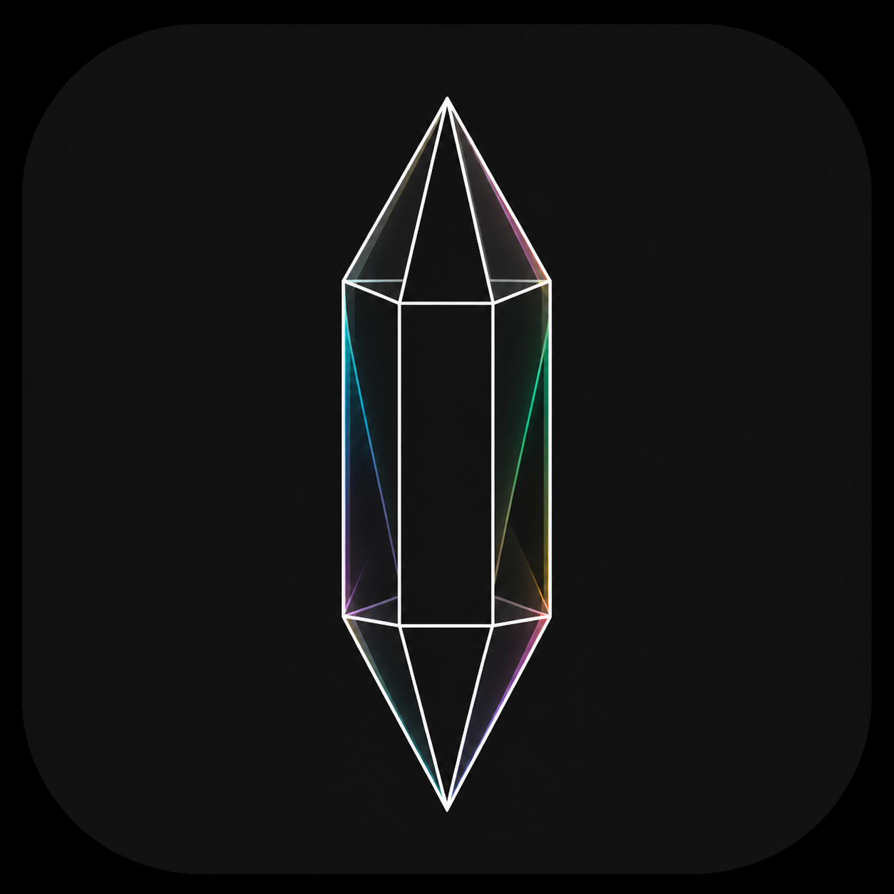

<p align="center">
  
</p>

<h1 align="center">Prism</h1>

A React component library for Roblox. Build interfaces with ready-made controls, shared themes, and built-in motion, using TypeScript or Luau.

- **Compose your UI.** Combine buttons, inputs, tabs, windows, and layout components in a React tree.
- **Make it yours.** Start with a light or dark theme, then customize colors, spacing, and component styles.
- **Use Roblox sizes.** Pass pixels, percentages, `UDim`, or `UDim2` wherever you need them.

## Installation

### TypeScript

```sh
npm install @3xjn/prism
```

Add `node_modules/@3xjn` to your `tsconfig.json` type roots:

```json
{
	"compilerOptions": {
		"typeRoots": ["node_modules/@rbxts", "node_modules/@3xjn"]
	}
}
```

In your Rojo project, map the `@3xjn` scope alongside `@rbxts` under your existing `node_modules` folder:

```json
"node_modules": {
	"$className": "Folder",
	"@rbxts": { "$path": "node_modules/@rbxts" },
	"@3xjn": { "$path": "node_modules/@3xjn" }
}
```

The npm package includes compiled Luau. Import components directly from `@3xjn/prism`.

### Luau

Use the native package with React-Luau. It includes Prism, React, ReactRoblox, and Luau types.

See [Prism for Luau](native/README.md) for installation and a complete example.

## Quick start

Wrap your interface in `ThemeProvider`, then compose components inside it:

```tsx
import React from "@rbxts/react";
import ReactRoblox from "@rbxts/react-roblox";
import { Button, Stack, Text, ThemeProvider } from "@3xjn/prism";

function Counter() {
	const [count, setCount] = React.useState(0);

	return (
		<Stack width={280} p="md" gap="sm">
			<Text text={`Count: ${count}`} size="lg" layoutOrder={1} />
			<Button label="Add one" onPress={() => setCount(count + 1)} layoutOrder={2} />
		</Stack>
	);
}

const screen = new Instance("ScreenGui");
screen.ZIndexBehavior = Enum.ZIndexBehavior.Sibling;
screen.Parent = game.GetService("Players").LocalPlayer.WaitForChild("PlayerGui");

const root = ReactRoblox.createRoot(screen);
root.render(
	<ThemeProvider>
		<Counter />
	</ThemeProvider>,
);
```

Run this on the client. When you remove the interface, call `root.unmount()` and destroy its `ScreenGui`.

## Themes

Prism uses a light theme by default. Choose the dark theme and compact spacing through the provider:

```tsx
import { DEFAULT_DARK_THEME, ThemeProvider } from "@3xjn/prism";

<ThemeProvider theme={DEFAULT_DARK_THEME} density="compact">
	<App />
</ThemeProvider>;
```

Components read colors, spacing, and motion settings from the provider. Use semantic colors such as `color="success"` on controls, and theme tokens or `Color3` values for concrete colors.

See [the design guide](DESIGN.md) for tokens and visual conventions.

## Layout and styling

`Stack` arranges children and controls their spacing. Use `layoutOrder` to choose their order, `gap` for space between them, and `p` for padding.

Sizes accept pixel numbers, percentage strings such as `"100%"`, and Roblox `UDim` / `UDim2` values. Spacing, radius, and text sizes also accept tokens from `"xs"` to `"xl"`.

Set text through `text` or `label` props. To customize a Roblox property a component does not expose, use `slotProps`:

```tsx
<Button
	label="Delete"
	color="error"
	variant="outline"
	slotProps={{
		root: { LayoutOrder: 10 },
		stroke: { Thickness: 2 },
	}}
/>
```

Slot properties override component defaults. Avoid overriding properties the component animates; use `styleOverrides` for state-dependent styles.

## Components

| Category       | Components                                                                                     |
| -------------- | ---------------------------------------------------------------------------------------------- |
| Layout         | `Box`, `Stack`, `Divider`, `Card`, `ScrollArea`                                                |
| Text and media | `Text`, `Icon`, `Image`, `Avatar`                                                              |
| Controls       | `Button`, `Pressable`, `Input`, `KeybindInput`, `Checkbox`, `Switch`, `StepperInput`, `Slider` |
| Feedback       | `Progress`, `CircularProgress`, `Backdrop`                                                     |
| Navigation     | `SegmentedControl`, `Tabs`, `Menu`, `Select`                                                   |
| Overlays       | `WorldPortal`, `Popover`, `Modal`, `Tooltip`, `Window`                                         |
| Utility        | `Draggable`                                                                                    |

Browse [the playground stories](src/playground/stories) for component examples. Run them in Studio with [UI Labs](https://ui-labs.luau.page/).

## Development

See [CONTRIBUTING.md](CONTRIBUTING.md) for local setup, native builds, and checks.

## License

[MIT](LICENSE).
